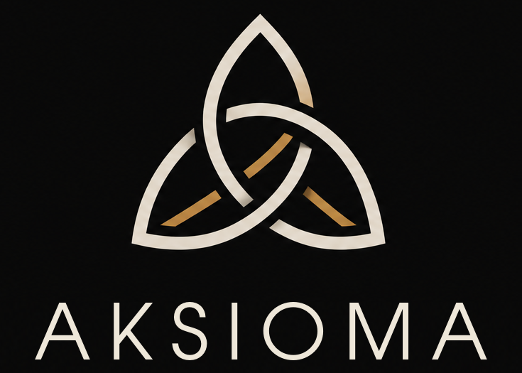

  

<h1 align="center">AKSIOMA: Nyjet</h1>

  Një laborator interaktiv 3D për teorinë e nyjeve: eksploroni nyje,
  llogaritni invariantet e tyre, identifikoni nyjet e vizatuara dhe shikoni
  si zgjidhen.

  <a href="https://github.com/Albionn1/AKSIOMA-Knots/releases/latest"><b>⬇ Shkarko për Windows</b></a>
  &nbsp;·&nbsp;
  <a href="#english">English</a>

---

## Shkarkimi

Shkarkoni **AKSIOMA-Knots-…-Setup.exe** nga
[versioni i fundit](https://github.com/Albionn1/AKSIOMA-Knots/releases/latest)
dhe hapeni. Instaluesi është në shqip dhe anglisht dhe kërkon Windows 10 ose
më të ri, 64-bit.

Instaluesi nuk është i nënshkruar, prandaj Windows SmartScreen mund të
shfaqë mesazhin "Windows protected your PC". Klikoni **More info → Run
anyway**.

Manuali i përdoruesit (PDF): [Shqip](Manual/AKSIOMA_Knots_Manual_SQ.pdf) ·
[English](Manual/AKSIOMA_Knots_Manual_EN.pdf) ·
[të dyja](Manual/AKSIOMA_Knots_Manual_EN_SQ.pdf)

## Mundësitë

- **Nyje në 3D**: nyje të gatshme, nyje torike T(p,q), kurba të
  personalizuara nga një formulë ose një listë koordinatash, me tuba të
  shndritshëm, satinë, metalikë ose litar.
- **Shfletuesi i nyjeve**: të 12 965 nyjet e thjeshta me deri në 13
  kryqëzime nga KnotInfo, me kërkim, filtra dhe invariantet e tyre.
- **Vizatoni një nyjë** me miun dhe klikoni kryqëzimet për të ndërruar se
  cili fill kalon sipër.
- **Invariantet**: polinomi i Aleksandrit dhe i Jonesit, përdredhja, numrat
  e lidhjes, numri i kryqëzimeve dhe identifikimi i nyjës në tabelë.
- **Animacioni i zgjidhjes**: ndryshime kryqëzimesh deri te një diagram
  zbritës, hap pas hapi, me diagramin e nyjës pranë.
- **Relakso dhe ngatërro** kurbën me një simulim fizik ku fijet nuk kalojnë
  kurrë njëra nëpër tjetrën.
- **Sipërfaqet e Seifertit**, të ndërtuara hap pas hapi, me matricën e
  Seifertit dhe lakoret pas çdo elementi të saj.
- **Ushtrime**: trengjyrësimi dhe shenjat e kryqëzimeve mbi diagramin e
  nyjës.
- **Skedarë**: ruani dhe hapni skedarë `.aknot`, ruani figura, diagrame
  (SVG, PNG) dhe koordinata.
- Shqip dhe anglisht, temë e errët dhe e çelët.

## Ndërtimi nga kodi burimor

Qt 6 me CMake; shihni [AKSIOMAKnots/BUILD.txt](AKSIOMAKnots/BUILD.txt).

## Falënderime

Tabela e nyjeve (format 3D, emrat dhe invariantet) vjen nga
[KnotInfo](https://knotinfo.math.indiana.edu/) (C. Livingston dhe
A. H. Moore). Ndërtuar me [Qt](https://www.qt.io/), i përdorur sipas
licencës LGPL v3.

## Licenca

Copyright © 2026 AKSIOMA. Softuer i lirë sipas
[GNU General Public License v3](AKSIOMAKnots/LICENSE).

---

## English

**AKSIOMA Knots** is an interactive 3D laboratory for knot theory: explore
knots, compute their invariants, identify drawn knots and watch them being
unknotted. Download the Windows installer from the
[latest release](https://github.com/Albionn1/AKSIOMA-Knots/releases/latest);
the program and the installer are in Albanian and English. See the
[English manual](Manual/AKSIOMA_Knots_Manual_EN.pdf).
